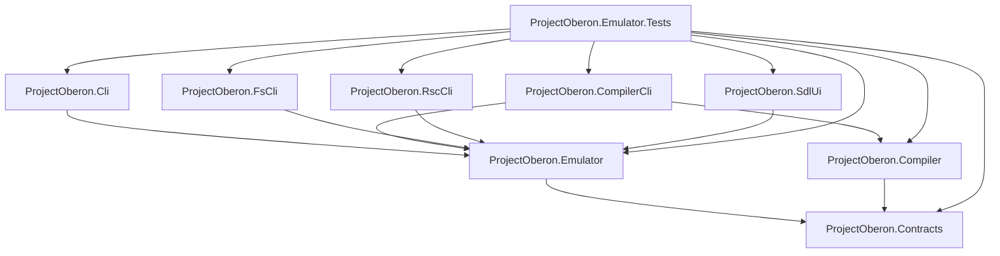

# ProjectOberon.NET architecture

The repository uses a one-way dependency graph. Shared contracts sit below the
emulator core and compiler; production adapters depend on the layers they use,
and no production project depends on tests.



The arrows mean “references”. The test project is intentionally the only
consumer of the adapters, because the repository uses one executable test
runner for emulator, compiler, CLI, RSC, filesystem, and SDL helper coverage.

## Folder hierarchy

```text
src/
  ProjectOberon.Contracts/      instruction and RSC data contracts
  ProjectOberon.Emulator/       core runtime, filesystem, RSC loading
  ProjectOberon.Compiler/       Oberon scanner, parser and code generator
  ProjectOberon.Cli/            machine/runtime CLI
  ProjectOberon.CompilerCli/   Oberon source compiler CLI
  ProjectOberon.FsCli/          disk filesystem CLI
  ProjectOberon.RscCli/         RSC inspection CLI
  ProjectOberon.SdlUi/          SDL frontend
tests/
  ProjectOberon.Emulator.Tests/ executable test runner
docs/
  architecture.md
```

The dependency rules are enforced by `ArchitectureTests` in the test runner.
Adding a project-to-project reference requires updating that test intentionally
instead of silently creating a reverse or adapter-to-adapter dependency.

Shared SDK settings (`net10.0`, nullable analysis, implicit usings, and warnings
as errors) live in the repository-level `Directory.Build.props`; individual
projects keep only project-specific settings and references.
