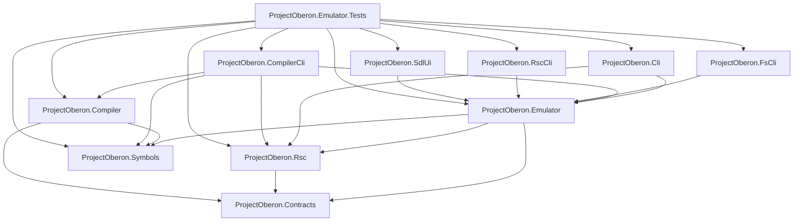

# ProjectOberon.NET architecture

The repository uses a one-way dependency graph. Shared contracts sit below the
emulator core and compiler; production adapters depend on the layers they use,
and no production project depends on tests.



The arrows mean “references”. The test project is intentionally the only
consumer of the adapters, because the repository uses one executable test
runner for emulator, compiler, CLI, RSC, filesystem, and SDL helper coverage.

## Folder hierarchy

```text
src/
  ProjectOberon.Contracts/      instruction and RSC data contracts
  ProjectOberon.Emulator/       core runtime and filesystem
  ProjectOberon.Compiler/       Oberon scanner, parser and code generator
  ProjectOberon.Rsc/            RSC reader, writer and validation
  ProjectOberon.Symbols/        SMB symbol-module model and reader
  ProjectOberon.Cli/            machine/runtime CLI
  ProjectOberon.CompilerCli/   Oberon source compiler CLI
  ProjectOberon.FsCli/          disk filesystem CLI
  ProjectOberon.RscCli/         RSC inspection CLI
  ProjectOberon.SdlUi/          SDL frontend
tests/
  ProjectOberon.Emulator.Tests/ executable test runner
docs/
  architecture.md
```

The dependency rules are enforced by `ArchitectureTests` in the test runner.
Adding a project-to-project reference requires updating that test intentionally
instead of silently creating a reverse or adapter-to-adapter dependency.

CodeGraph also indexes symbol-level references. Its unresolved-reference count
includes framework symbols such as `List`, `Console` and exception types,
test fixture helpers, and some C# alias/partial-method patterns. Those are not
project dependency edges; the authoritative project-direction check is the
`.csproj` graph asserted by `ArchitectureTests`.

Refresh the source dependency index after structural changes with:

```sh
codegraph sync .
```

Then run the solution build and the fast test binary to verify both project
references and runtime behavior.

Shared SDK settings (`net10.0`, nullable analysis, implicit usings, and warnings
as errors) live in the repository-level `Directory.Build.props`; individual
projects keep only project-specific settings and references.

## Boundary rules

Binary codecs validate representability before writing: directory and boot
names are ASCII, text and rider payloads reject NUL or non-Latin-1 characters,
and file page tables cannot address more pages than the on-disk extension
table supports. UI input helpers validate dimensions before scaling. These
checks keep malformed host input from becoming silently corrupted Oberon data.
